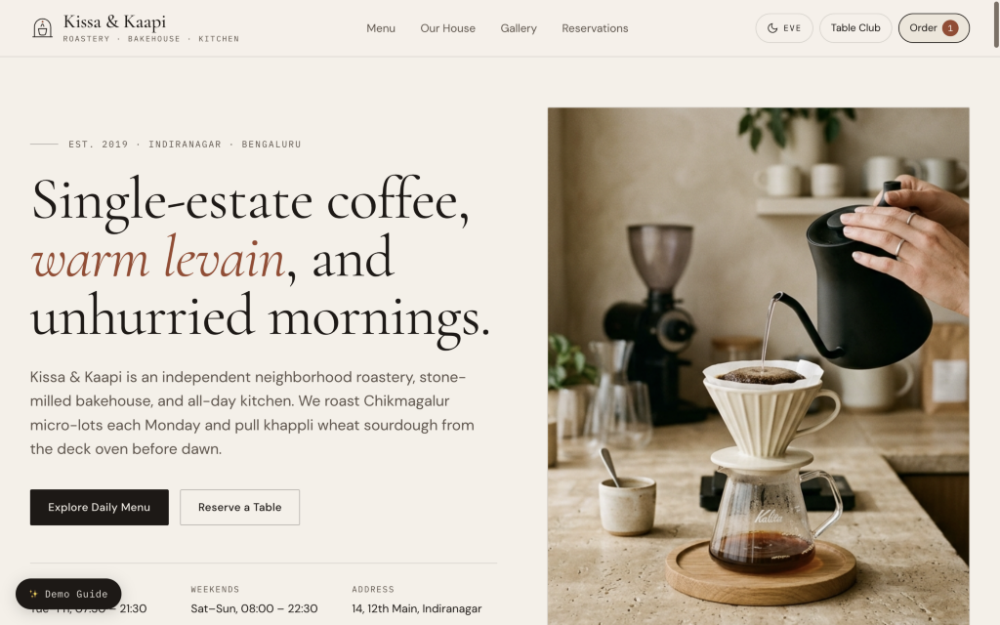
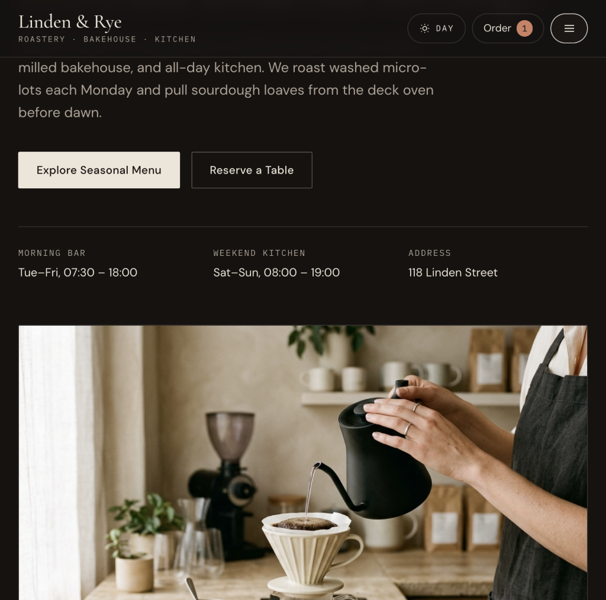
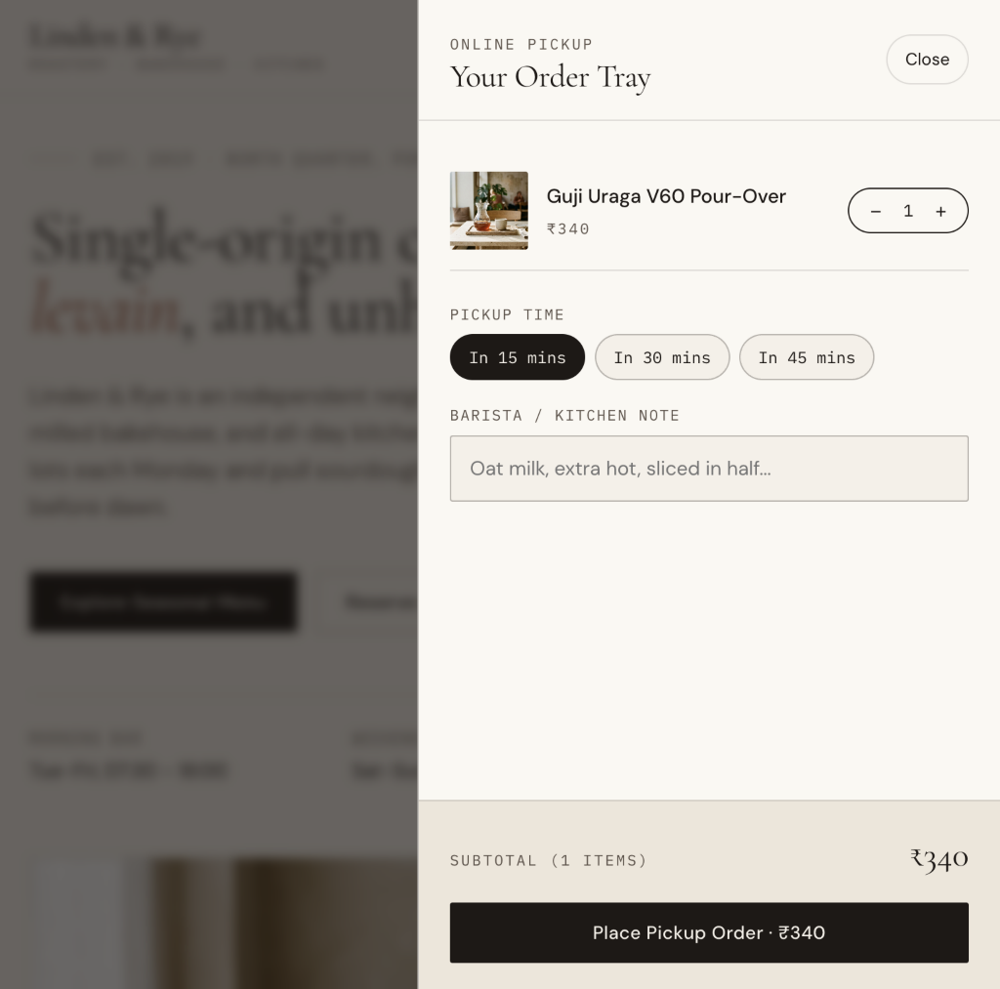
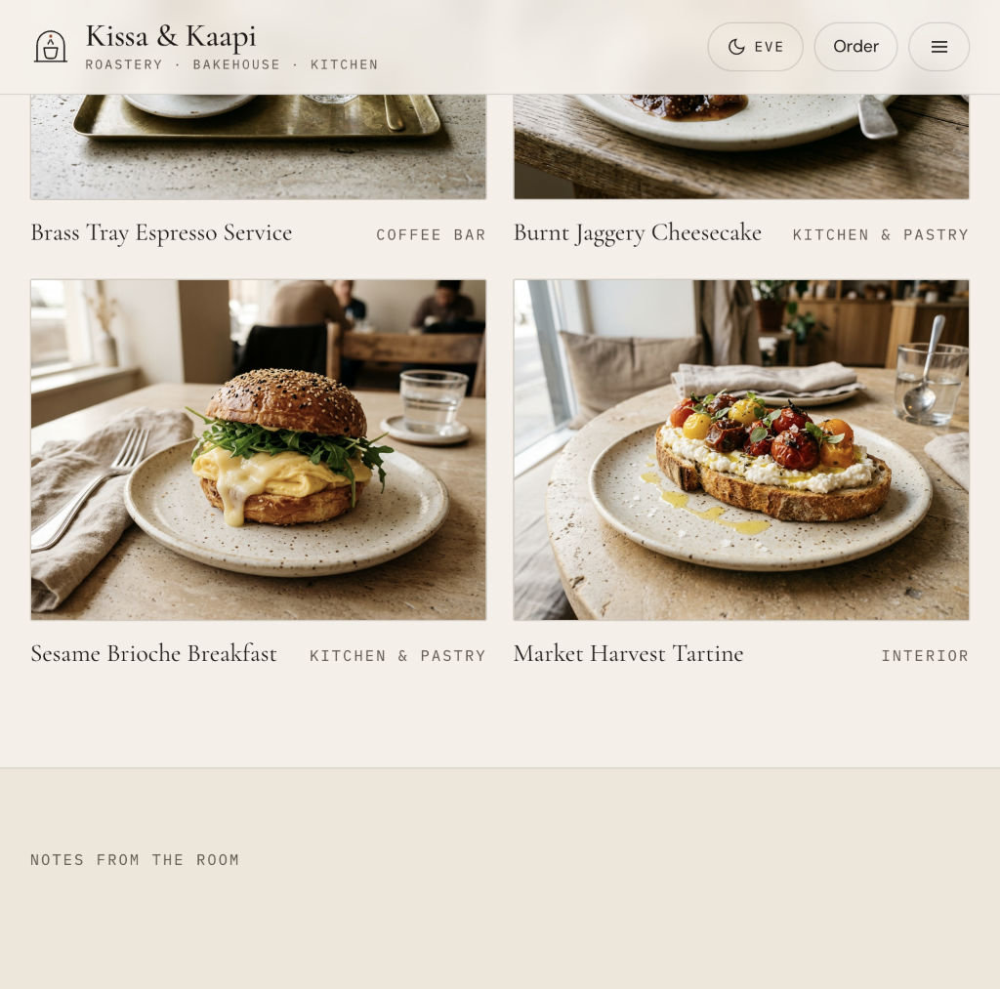
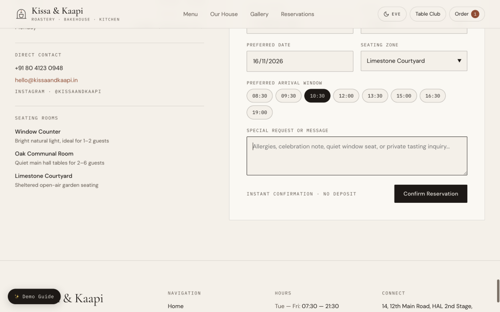
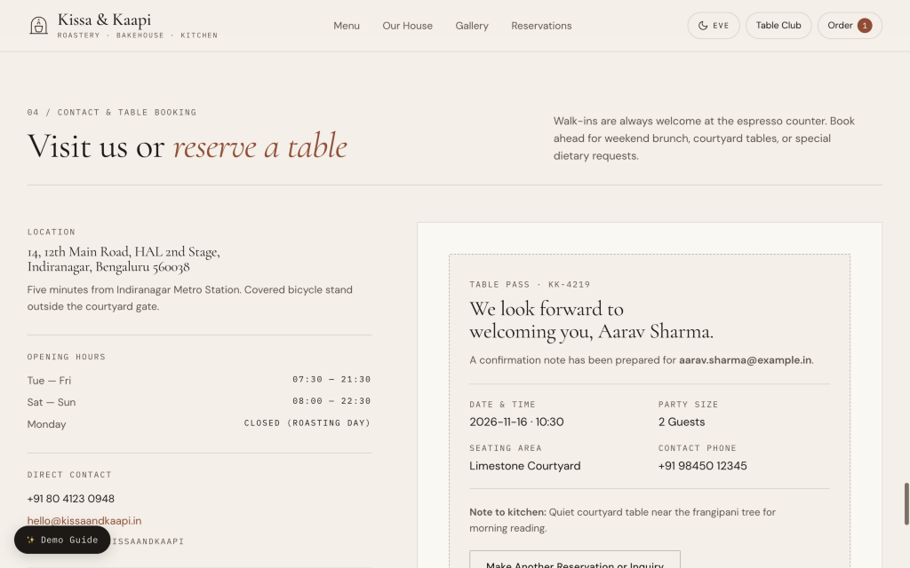
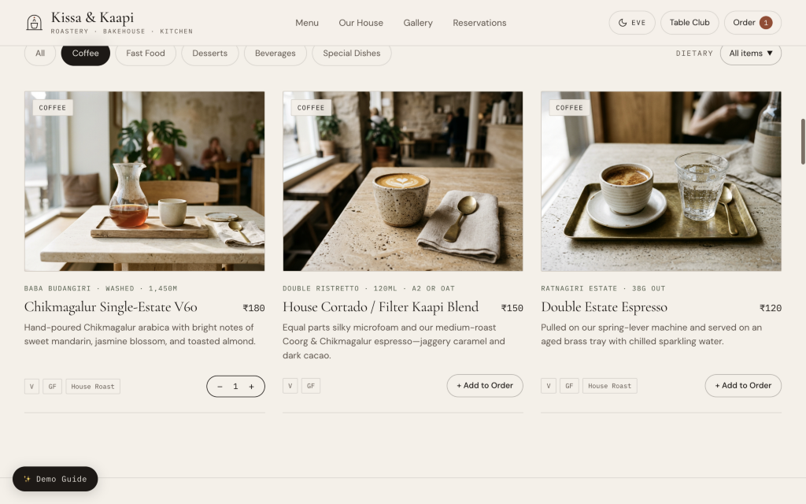
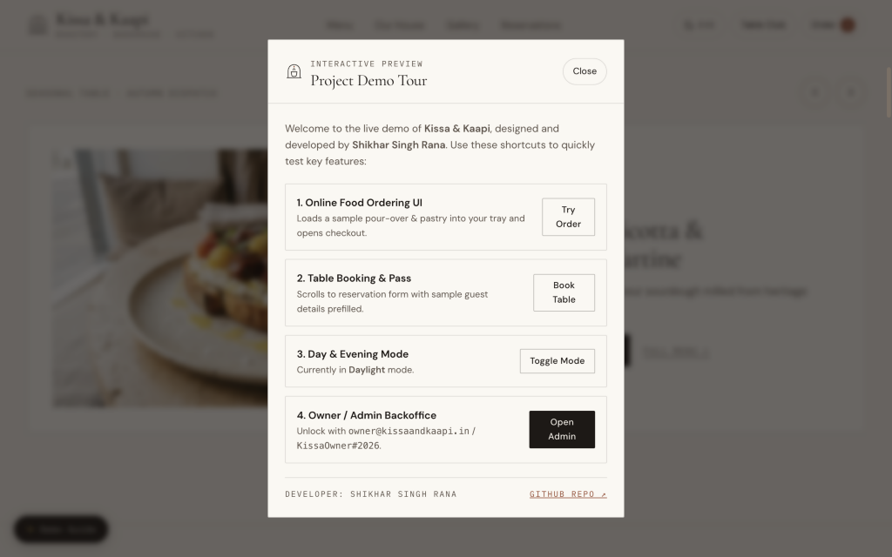
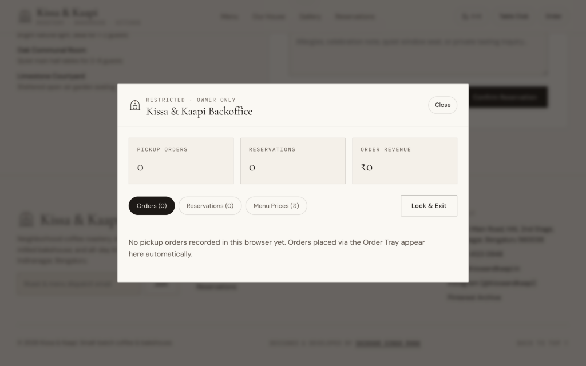
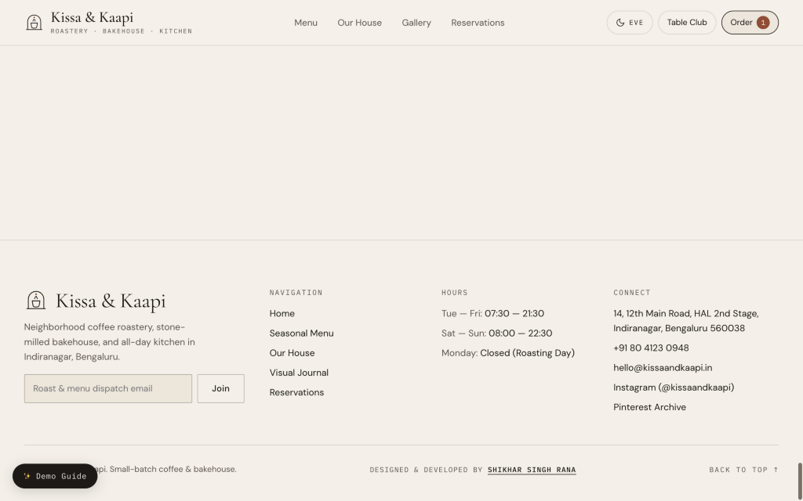

# Kissa & Kaapi — Roastery · Bakehouse · Kitchen

A modern, responsive, and aesthetic website for **Kissa & Kaapi**, an independent specialty coffee roastery, stone-milled bakehouse, and all-day kitchen located in Indiranagar, Bengaluru.

Designed with an editorial, warm Kinfolk/Pinterest aesthetic: natural earth-and-limewash palettes, hairline borders, Cormorant Garamond serif typography paired with DM Sans and IBM Plex Mono, and 35mm-film-style photography.

---

## 🌟 Live Demo & Visual Showcase

- **Live GitHub Pages URL**: [https://shikharsinghrana0-hash.github.io/kissa-and-kaapi/](https://shikharsinghrana0-hash.github.io/kissa-and-kaapi/)
- **Interactive In-App Tour**: Click the **✨ Demo Guide** button in the bottom-left corner of the site to test 1-click sample orders, prefilled table bookings, theme switching, or admin backoffice tools.

### 📸 Demo Gallery

| **01. Homepage & Editorial Hero (Daylight)** | **02. Evening Dark Mode & Order Badge** |
| :---: | :---: |
|  |  |

| **03. Online Pickup Ordering Tray** | **04. 12-Frame Visual Journal Gallery** |
| :---: | :---: |
|  |  |

| **05. Table Reservation Booking Form** | **06. Instant Confirmed Table Pass** |
| :---: | :---: |
|  |  |

| **07. Seasonal Menu & Indian Rupee (₹) Pricing** | **08. Interactive In-App Demo Tour** |
| :---: | :---: |
|  |  |

| **09. Secured Owner / Admin Backoffice** | **10. Developer Credits by Shikhar Singh Rana** |
| :---: | :---: |
|  |  |

---

## ☕ Key Features

1. **Homepage & Hero Section**:
   - Asymmetric split editorial layout with headline typography and natural light photography.
   - Dual Call-to-Actions (*Explore Daily Menu* and *Reserve a Table*).
   - Live house notes, operating hours, and location metadata.

2. **Seasonal Highlights Carousel**:
   - Native CSS scroll-snap carousel with previous/next controls and slide markers.
   - Live polite status announcements for accessibility.
   - Direct *Add to Order* integration from featured slides.

3. **Menu Section (Reasonable Indian Pricing ₹)**:
   - 5 complete categories: **Coffee**, **Fast Food**, **Desserts**, **Beverages**, and **Special Dishes**.
   - Dietary filters: *All*, *Vegetarian (V)*, *Gluten-Free (GF)*, and *House Roast*.
   - Each item includes photography, origin/prep metadata, descriptions, pricing in Indian Rupees (`₹120` to `₹490`), and inline quantity steppers.

4. **Online Food Ordering / Pickup Tray**:
   - Slide-over order tray with real-time subtotal calculation in INR.
   - Pickup time windows (*15 mins*, *30 mins*, *45 mins*) and barista/kitchen notes.
   - Generates an instant pickup ticket with unique order code.

5. **About Us Section**:
   - The brand story of Kissa & Kaapi, focusing on direct-trade Indian estates (Chikmagalur, Baba Budangiri, Coorg) and 48-hour stone-milled khappli levain.
   - 4 foundational craft pillars and dining room details.

6. **Contact & Table Reservation System**:
   - Comprehensive contact details, operating hours, address, and seating zones (Window Counter, Oak Room, Limestone Courtyard).
   - Validated reservation form with accessible error handling (`:user-invalid` synchronized with `aria-invalid`).
   - Generates an instant printable **Table Pass** upon submission.

7. **Visual Journal & Photo Gallery**:
   - 12 curated editorial photographs across Interior, Coffee Bar, and Kitchen & Pastry.
   - Interactive category filtering and a native modal Lightbox with Previous/Next slide navigation.

8. **Testimonials**:
   - Guest notes and reviews from food editors and neighborhood regulars.

9. **Day & Evening Dark Mode**:
   - Seamless Day/Eve theme toggle supporting system preference (`color-scheme: light dark`) and user persistence.

10. **Table Club Member Auth**:
    - Sign In and Create Account modal for café regulars.

11. **Secured Owner Portal (Admin Backoffice)**:
    - Kept completely invisible to regular visitors (no visible admin links).
    - Accessible only via private hash (`#owner-portal`) or keyboard shortcut (`Ctrl+Shift+K` / `Cmd+Shift+K`).
    - Protected with SHA-256 passcode verification and lockout guards.
    - Allows the owner to view live orders, manage table reservations, and adjust menu prices live.

---

## 🛠️ Tech Stack

- **Framework**: React 19 + Vite
- **Styling**: Modern Vanilla CSS with CSS custom properties, container queries, clamp fluid scaling, and CSS scroll snap
- **Typography**: Cormorant Garamond, DM Sans, IBM Plex Mono (Google Fonts)
- **Accessibility**: Semantic HTML5, native `<dialog>` modals with scroll locks, and synchronized ARIA validation

---

## 🚀 Getting Started

### Prerequisites
- Node.js (v18 or higher recommended)
- npm

### Installation
```bash
# Clone the repository
git clone https://github.com/shikharsinghrana0-hash/kissa-and-kaapi.git

# Navigate into the project folder
cd kissa-and-kaapi

# Install dependencies
npm install

# Start local development server
npm run dev
```

### Production Build
```bash
# Build production bundle
npm run build

# Preview production build locally
npm run preview
```

---

## 🔒 Owner / Admin Access

To access the backoffice panel:
1. Navigate to: `http://localhost:5173/#owner-portal` (or press `Cmd+Shift+K` on Mac / `Ctrl+Shift+K` on Windows).
2. Enter owner credentials:
   - **Email**: `owner@kissaandkaapi.in`
   - **Passcode**: `KissaOwner#2026`

---

## 👨‍💻 Developer

**Shikhar Singh Rana**
- **GitHub**: [@shikharsinghrana0-hash](https://github.com/shikharsinghrana0-hash)
- **Project**: Kissa & Kaapi Specialty Cafe Website
